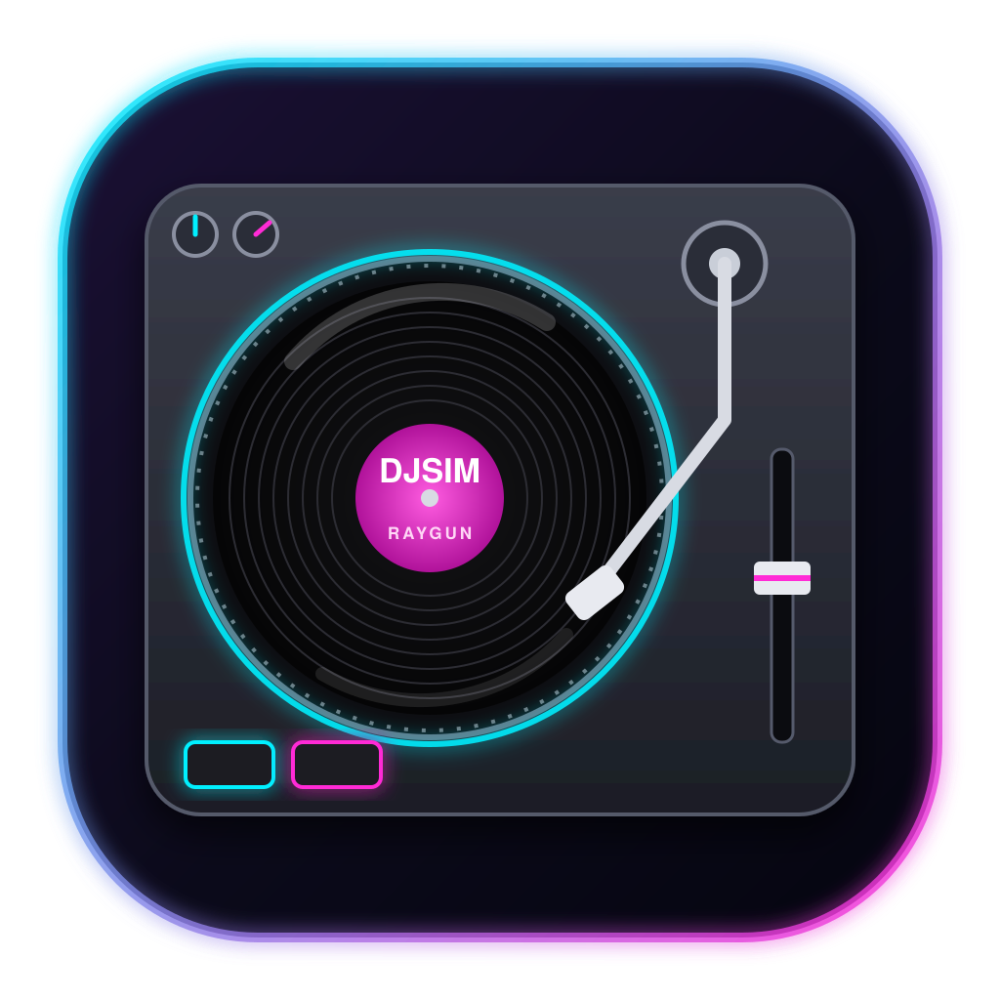

# DJSIM by Raygun

<p align="center"></p>

**DJSIM** is a 3D music visualizer that turns a DJ set into a living club or festival. It listens to your music (a demo set, your own tracks, or your mixer's live output) and drives a stage full of lasers, moving heads, LED walls, strobes, pyro, CO2 and confetti. A crowd of up to 2,500 people dances to it, and every one of them has a name, a backstory, a taste in music and a story that unfolds through the night.

## Download (macOS)

1. Open the **[latest release](https://github.com/raygunsinewave-oss/sim/releases/latest)**.
2. Download the right file for your Mac:
   - Apple Silicon (M1/M2/M3/M4): `DJSIM-<version>-arm64.dmg`
   - Intel: `DJSIM-<version>-x64.dmg`
3. Open the DMG and drag **DJSIM** into **Applications**.
4. **First launch:** this build isn't notarized by Apple, so macOS will warn you. Either:
   - right-click DJSIM in Applications → **Open** → **Open**, or
   - run `xattr -cr /Applications/DJSIM.app` in Terminal, then open it normally.
5. Click **Enter the club**. The Demo DJ starts right away.

## Feeding it your DJ set

| Source | How |
|---|---|
| **Demo DJ** | A built-in procedural set that moves through house, techno, trance, dubstep, drum & bass, disco, hardstyle, hip-hop and tech house, with real build-ups and drops. |
| **Files** | Drag and drop tracks (MP3/WAV/FLAC/M4A/AAC/OGG/AIFF) or press ⌘O. Auto-mix equal-power crossfades between tracks like a DJ. ID3 title/artist (or `Artist - Title.mp3` filenames) are read so the crowd can recognise anthems. |
| **Live Input** | Pick your audio interface or mixer input in Settings → Live input device. macOS will ask for microphone permission. To capture other apps on your Mac, route them through a loopback driver like [BlackHole](https://github.com/ExistentialAudio/BlackHole). |
| **System Audio** | Experimental screen-capture loopback. |

When playing live, use **Crowd → Tell the crowd what's playing** to tag an anthem so the crowd reacts to it.

## What's inside

- **Real-time analysis** on the audio thread: 7-band spectrum, onset detection, BPM and beat phase (autocorrelation + comb filter), bars and phrases, section detection (intro / groove / breakdown / build-up / **drop**), genre estimation and an energy/hype model.
- **The crowd**: instanced, articulated bodies with diverse heights, builds, skin tones, hair styles, outfits, hats, phones, glowsticks and drinks. 30 procedural moves (bounce, fist-pump, shuffle, skank, hardstyle stomp, half-time head nod, trance hands, disco point, couples dancing, clapping, filming…) blended by genre, section, personal taste, rhythm skill and stamina. Everyone is slightly off-beat in their own way.
- **Crowd moments**: staggered drop reactions, crouch-and-jump on build-ups, mosh pits that open for heavy genres, dance circles around battlers, people climbing onto friends' shoulders, crowd surfing, trips to the bar, tired breaks and second winds.
- **Stories**: 24 archetypes, friend groups and couples, backstories, goals for the night (get to the barrier, find a lost friend, propose during *their* song…), and a timestamped story log. Click anyone to read their Story Card, follow them, or see the show from their eyes.
- **Anthem recognition**: 78 well-known dance anthems (metadata only). When one plays, recognition ripples out from the front. Superfans scream, some people film, some don't know it.
- **21 worlds**: Warehouse Rave, Mainstage Festival, Techno Bunker, Ibiza Sunset Beach Club, Neo-Tokyo Rooftop, Basement Boiler Room, Desert Playa Sunrise, Cyber Neon Club, Ice Cave, Jungle Temple, Orbital Space Station, Stadium Night, Gothic Cathedral Rave, Forest Clearing, Superyacht Party, Retro 80s Synthwave, Underwater Dome, Volcano Crater, Northern Lights Tundra, Rainy Underpass and Sky Arena.
- **15 LED-wall visualizers**, **9 laser modes**, **10 moving-head patterns**, **16 palettes**, **44 presets**, **8 camera modes** including a cinematic auto-director, and an **Auto-VJ** that changes the look on phrase boundaries and saves the biggest moments for drops.

## Keyboard shortcuts

| Key | Action | Key | Action |
|---|---|---|---|
| `Space` | Drop | `S` (hold) | Strobe |
| `B` | Blinders | `P` | Pyro |
| `X` | CO2 jets | `C` | Confetti |
| `W` | Fireworks | `Z` | Sparks |
| `V` | Next LED visual | `K` | Next laser mode |
| `M` | Next light pattern | `L` | Lasers on/off |
| `E` | Next world | `1`–`9` | Presets |
| `N` | Next palette | `F` | More haze |
| `R` | Random story | `G` | Follow selected person |
| `0` | Cinematic camera | `Shift+C` | Free camera |
| `J` | Auto-VJ on/off | `T` | Next track |
| `Tab` | Hide interface | `H` | Help |

Mouse: drag to orbit, scroll to zoom, click a person for their story, click the LED wall to change visuals, click a laser to change its mode, double-click the stage for a drop.

## Building from source

```bash
npm install
npm start                # run in development
npm run dist:mac         # build DJSIM-<version>-arm64.dmg and -x64.dmg into dist/
```

Every push to `main` builds both Mac versions on GitHub Actions (`.github/workflows/build-macos.yml`) and publishes them to the release for the version in `package.json`.

The renderer is plain ES modules with no bundler, so you can also open `src/` from any static web server (`python3 -m http.server` in `src/`) to work on visuals in a browser.

## Project layout

```
main.js / preload.js       Electron shell (custom app:// protocol, mic permission, menus)
src/index.html, styles.css UI
src/js/audio.js            Sources: demo, files + auto-mix decks, live input, system audio
src/js/onset-worklet.js    Audio-thread onset envelope
src/js/analysis.js         Bands, beats, BPM, sections, drops, genre, energy
src/js/demo.js             Procedural Demo DJ
src/js/personas.js         Names, archetypes, backstories, goals, story lines
src/js/crowd.js            Instanced crowd, dance moves, behaviour AI
src/js/environments.js     21 worlds
src/js/lights.js, lasers.js, effects.js, visualizers.js, dj.js, camera.js, presets.js, ui.js, app.js
PROMPT.md                  The full product spec / build prompt
```

Three.js (MIT) is vendored in `src/vendor/three`.
